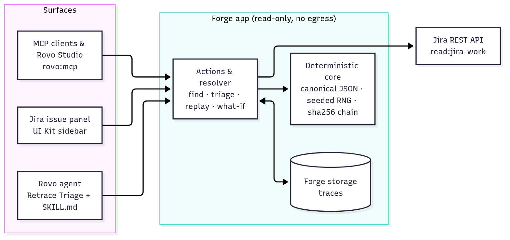
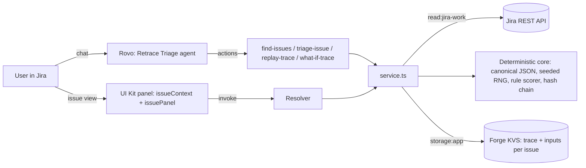

# Retrace

**Auditable Rovo triage for Jira.** AI agents are great at triage, but nobody can check *why* they decided something, or whether they'd decide the same thing tomorrow. Retrace is a Forge app (Codegeist 2026) where every triage decision (priority, labels, assignee) is recorded as a deterministic, sha256 hash-chained trace, with the reasons written out in plain words. From Rovo chat or the Jira issue view you can:

- **Triage + record**: get a suggested priority, labels and assignee, with reasons and a root hash.
- **Replay**: rerun the stored trace and get a **Verified** or **Mismatch** badge for every step hash.
- **What-if**: pretend the issue had other labels or a forced priority, and see a before → after diff without changing anything.

Same inputs → same hash, every time.

## Architecture





The core (`src/core`) is pure TypeScript with no Forge imports, so it is fully unit-tested.

## Modules
| Module | Key | Purpose |
| --- | --- | --- |
| `rovo:agent` | `retrace-agent` | "Retrace Triage" agent with conversation starters for triage, replay and what-if |
| `action` | `find-issues`, `triage-issue`, `replay-trace`, `what-if-trace` | Tools the agent calls |
| `jira:issueContext` | `retrace-context` | "Retrace trace" section in the issue sidebar |
| `jira:issuePanel` | `retrace-panel` | Same UI as an issue panel |

## How the scorer works
Rules are keyword and label based and written into the trace, so every point is explained:

| Label | Example words | Points |
| --- | --- | --- |
| security | security, vulnerability, auth, token, leak, password | +5 |
| outage | outage, down, unavailable, 500/502/503 | +5 |
| data-loss | data loss, corrupt, deleted, lost | +4 |
| crash | crash, freeze, hang | +4 |
| performance | slow, latency, timeout, memory | +3 |
| bug | bug, error, broken, fails, regression (or issue type Bug) | +2 |
| ux | button, layout, css, typo, display | +1 |
| docs | docs, documentation, readme | −1 |

The issue type sets the starting score (Incident 3, Bug 2, other types 1). Urgency words (urgent, blocker, production, all users) add +2. Existing Jira labels with these names count too. Final score: **≥9 Highest, 6–8 High, 3–5 Medium, 1–2 Low, ≤0 Lowest**. The assignee is the best skill match with the fewest open issues, and ties are broken by the seeded RNG.

## How determinism works
- Every step's input and output is serialized as canonical JSON (sorted keys, no whitespace, order-insensitive lists sorted).
- A seeded PRNG (mulberry32, seed derived from the issue key) breaks ties, so "random" is reproducible.
- Each step hash = `sha256(prevHash | canonical(step))`, chained from a zero genesis hash; the last one is the root hash.
- The clock is injected and never hashed, so re-triaging an unchanged issue gives the same root hash.
- Replay re-executes from the stored inputs and compares every step hash. What-if reruns with the same seed, so only your changes can move the outcome.
- Traces carry an engine version. Traces from older versions are shown as "legacy, re-triage" instead of an error.

## Develop
Requires Node 22.23+ (Forge CLI requirement).
```sh
npm install
npm test           # vitest, pure core
npm run typecheck  # tsc --noEmit
npm run lint       # forge lint
```

## Deploy and install
```sh
npm install -g @forge/cli
forge login        # email + API token from id.atlassian.com
forge register     # only for your own copy: replaces app.id in manifest.yml
forge deploy
forge install      # pick your Jira Cloud site (Rovo needs a site with Rovo enabled)
```

Then open any Jira issue, find **Retrace trace** in the sidebar, and click **Triage + record**. In Rovo chat, pick the **Retrace Triage** agent.

See [docs/demo-script.md](docs/demo-script.md) and [docs/judges.md](docs/judges.md).

License: MIT

## What-if: removing labels

Removing a label in a what-if (panel checkbox or Rovo `removeLabels`) also stops the scorer from re-detecting it in the issue text. The suppressed labels are recorded in the `detect-labels` step input, so what-if hashes stay deterministic; normal traces (no removals) hash exactly as before.

## MCP server and skill (Atlassian MCP)

Retrace exposes its four actions as MCP tools through a `rovo:mcp` module (**Retrace MCP**): `find-issues`, `triage-issue`, `replay-trace`, `what-if-trace`. The same handlers back the Rovo agent, the issue panel and MCP, so traces are identical whichever surface you use.

An open-source agent skill lives at [`skills/retrace-triage/SKILL.md`](skills/retrace-triage/SKILL.md). It is packaged as a `rovo:skill` (used by the Retrace Triage agent) and can be copied into any third-party agent that supports `SKILL.md`.

**Use it from an MCP client (Claude, Cursor, VS Code…):**
1. A site admin enables it: admin.atlassian.com → Apps → Sites → your site → Connected apps → Retrace → turn on the tools.
2. Add the remote MCP server `https://mcp.atlassian.com/forge/2b9b66b6-b31e-4dcd-810f-9b73f6cf9015` to your client.
3. Approve the OAuth consent screen and pick the site. Tools run with your own Jira permissions.
4. Optionally add `skills/retrace-triage/SKILL.md` to your agent, then ask: "Triage the newest issue in project KAN, then replay it."

**Use it in Rovo Studio:** create a custom agent and add the Retrace MCP tools.

## Install (judges and testers)

Use the **[Retrace install link](https://developer.atlassian.com/console/install/2b9b66b6-b31e-4dcd-810f-9b73f6cf9015?signature=AYABeJPb8rNvI0JRhkbPWPL6fcIAAAADAAdhd3Mta21zAEthcm46YXdzOmttczp1cy13ZXN0LTI6NzA5NTg3ODM1MjQzOmtleS83MDVlZDY3MC1mNTdjLTQxYjUtOWY5Yi1lM2YyZGNjMTQ2ZTcAuAECAQB4CxqLTo9l4lqXuFjNim1xJM%2Bp%2F3TVP9xHS2BrU5DRRucB3XXQNZsR5754IU%2BGMj7HUAAAAH4wfAYJKoZIhvcNAQcGoG8wbQIBADBoBgkqhkiG9w0BBwEwHgYJYIZIAWUDBAEuMBEEDOWE4hdSLjHnL9OMdgIBEIA79Vg%2BcPAKMA3CVkbRTYiVWHykEdm%2BUFMEl9UwRjn3fZO%2FXZLewTwpXb5NiQSEf6QJ1V0amZpaED360RkAB2F3cy1rbXMAS2Fybjphd3M6a21zOmV1LXdlc3QtMTo3MDk1ODc4MzUyNDM6a2V5LzQ2MzBjZTZiLTAwYzMtNGRlMi04NzdiLTYyN2UyMDYwZTVjYwC4AQICAHi9bVMAkme4qVQX1fQHo6ePw3H40A7cGfz7yrmSfBWMXgElEBlFlAcBEXe1uje7%2FMMkAAAAfjB8BgkqhkiG9w0BBwagbzBtAgEAMGgGCSqGSIb3DQEHATAeBglghkgBZQMEAS4wEQQMhiDuGf88YsuYXcwmAgEQgDucoI29afF72AhJEhlNVFSCN4BmQAxFWaVzZWx5jsMZdkwRy7sWubY05OnXnZ0kD6Wi0AhmHd%2FoQyVlsgAHYXdzLWttcwBLYXJuOmF3czprbXM6dXMtZWFzdC0xOjcwOTU4NzgzNTI0MzprZXkvNmMxMjBiYTAtNGNkNS00OTg1LWI4MmUtNDBhMDQ5NTJjYzU3ALgBAgIAeDYASx0XCjkny4iLV6vz%2BKtEGSGT6kdt0QRpkn6D%2FlVEAWYO%2F0TtZ4JN6Sj4N6u3bkwAAAB%2BMHwGCSqGSIb3DQEHBqBvMG0CAQAwaAYJKoZIhvcNAQcBMB4GCWCGSAFlAwQBLjARBAwTIxOV3iMFBRifFqECARCAO8pjvTcn5e4KfW0GV8CD5MT4rs%2FsbNI2i6p4WYEMAsVXnaK8KxU8lie2wuppUk3ODllswk6Cer621pcKAgAAAAAMAAAQAAAAAAAAAAAAAAAAAF5bsMyVmuTJSsg0gjZTW83%2F%2F%2F%2F%2FAAAAAQAAAAAAAAAAAAAAAQAAADKfWFD%2BTdlm7yZflZj%2FIcYEt7aPjEPbStzjTi0EWqJtJ9SSJD3aI1A1q1x%2B9vL0lrpPEyBy1Nt4Q9m3QE7eMM2UqRg%3D&product=jira)** (steps in [docs/judges.md](docs/judges.md#install-retrace)) (site admin required). Developers can instead run `forge deploy -e development && forge install`.

## Privacy

Retrace stores one trace per triaged issue in Atlassian-hosted Forge storage. A trace contains the issue key, summary, description, labels, components and type, plus the Atlassian account IDs and display names of the project's assignable users (used for the assignee suggestion).

- No data leaves Atlassian: no external egress and no third parties.
- Retention: a trace is kept until the issue is triaged again (replaced) or the app is uninstalled.
- Read-only and advisory: Retrace never edits issues.
- Contact: randyidaeho7@gmail.com
